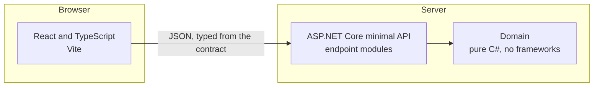

# Architecture overview

For lead engineers. The architecture falls out of the stories and the contract; each choice
below links to the decision that made it.

## Containers

## Layers and lanes

| Layer | Project | Lane | Rule |
|---|---|---|---|
| Contract | `contracts/openapi.yaml` | Human | Written first. The API and the client are both held to it. |
| Domain | `src/BillTracker.Domain` | Human | No framework references. The architecture test enforces it. |
| API | `src/BillTracker.Api` | Agent, reviewed | One `IEndpointModule` per feature. `Program.cs` never changes for a feature. |
| Web | `web/` | Agent, reviewed | Client types generated from the contract. Never hand-edited. |
| Content | `content/` | Human | Curated, not generated. |

## Decisions

- (Link each decision record here as it is accepted.)
